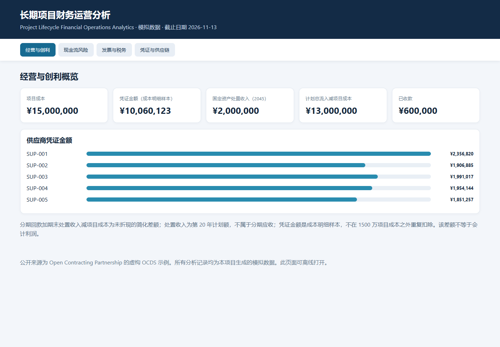

# Project Lifecycle Financial Operations Analytics

## 中文说明

### 项目背景与痛点

这是一个长期项目财务运营分析的**模拟案例**：项目基础成本 1500 万元，分 20 年每年计划回款 130 万元，并在第 20 年计划取得固定资产报废处置收入 200 万元。分期回款合计 2600 万元，连同处置收入的计划总流入为 2800 万元。长期项目常见的审核难点包括原始凭证数量多、发票与凭证金额不一致、跨期开票需要复核，以及应收与实收在不同年份分散。仓库把这些问题做成可重复构建的四张关联 CSV，并提供 SQL、Pandas Notebook 和四视图看板。

### 数据性质与来源

公开来源是 [Open Contracting Partnership 的虚构 OCDS 合同示例](https://github.com/open-contracting/sample-data/tree/703affda90d0fb16a7cbfd0ee126ac77261d3d06/fictional-example/1.1)，仅用于合同元数据和数据结构参考。**四张 CSV 中的财务记录全部由本项目模拟生成**；不是从公开平台取得的真实凭证、税票或回款记录。来源版本、许可和逐项假设见 [数据来源说明](docs/data_sources.md)。

### 技术栈与核心逻辑

- Python 标准库生成四张 CSV，Pandas 与 NumPy 执行 Notebook 分析，SQLite 语法的 SQL 输出对账异常。
- 合同表通过 `contract_id` 关联凭证、发票和年度现金流；凭证通过 `invoice_id` 关联发票。表粒度与关系见 [数据设计](docs/data_design.md)。
- 金额差异 = 发票未税金额 − 关联凭证金额合计；重复单据号按合同和单据号判定；逾期应收仅统计截止日之前到期且未收的金额。跨期发票是复核提示，不自动判定违规。
- 分期回款加期末处置收入减项目基础成本为**未折现计划差额 1300 万元**，不等于会计利润。凭证金额属于成本明细样本，不在 1500 万元基础成本之外重复扣除。

### 运行方法

```bash
python scripts/build_data.py --as-of-date 2026-11-13
python scripts/validate_data.py
python scripts/build_notebook.py
python scripts/build_dashboard.py
```

如需在 Jupyter 中运行 [风险分析 Notebook](notebooks/risk_analysis.ipynb)，先安装 `requirements.txt` 中的 Pandas 和 NumPy。`scripts/capture_dashboard.py` 仅用于重新生成截图，依赖 Playwright 和本地 Edge。已生成的四视图 [离线看板](powerbi/dashboard.html) 可直接在浏览器打开。

预期数据量：1 条合同、840 条凭证、420 条发票、20 条年度回款。SQL 已识别 20 条发票金额差异、6 组重复单据号、80 条跨期复核以及 1 条逾期回款。

### 看板截图



其他视图：[现金流风险](powerbi/dashboard_cash.png) · [发票与税务](powerbi/dashboard_tax.png) · [凭证与供应链](powerbi/dashboard_vouchers.png)。四个视图及 Power BI 导入方法见 [Power BI 搭建说明](powerbi/POWER_BI_GUIDE.md)。原生 [四页 PBIX](powerbi/Project_Lifecycle_Financial_Operations_Analytics.pbix) 已在 Power BI Desktop 中打开并保存；离线 HTML 看板和截图也可供本地审核。

## English guide

### Background and problem

This is a **synthetic** long-term project finance case with a CNY 15 million base project cost, twenty annual planned receipts of CNY 1.3 million each, and CNY 2 million terminal asset disposal proceeds in year 20. It demonstrates document volume review, invoice-to-voucher reconciliation, cross-period invoice review, and receivable monitoring. The repository includes four linked CSV files, a SQL exception query, a Pandas notebook, and a four-view offline dashboard.

### Provenance and method

The public source is the [Open Contracting Partnership fictional OCDS example](https://github.com/open-contracting/sample-data/tree/703affda90d0fb16a7cbfd0ee126ac77261d3d06/fictional-example/1.1). It supplies contract metadata and schema inspiration. **Every financial record in the four CSVs is generated**, not a real invoice, voucher, tax filing, or payment. See [provenance](docs/data_sources.md) and [data model](docs/data_design.md).

The builder uses Python's standard library and a fixed seed. The notebook uses Pandas and NumPy. SQL reports invoice amount variance, repeated document references, cross-period review flags, and overdue receivables. The undiscounted plan surplus is CNY 28 million of planned inflows less CNY 15 million of base project cost, or CNY 13 million; it is not accounting profit. Voucher amounts are cost detail samples and are not deducted twice.

### Run and review

Run the four commands above from the repository root. Open [dashboard.html](powerbi/dashboard.html) in a browser and the [notebook](notebooks/risk_analysis.ipynb) in Jupyter. The four report views cover operations and margin, cash risk, invoice and tax review, and vouchers and suppliers. Use the [local review checklist](docs/review_checklist.md) before publication.


The native [four-page PBIX](powerbi/Project_Lifecycle_Financial_Operations_Analytics.pbix) was opened and saved in Power BI Desktop. The [Power BI guide](powerbi/POWER_BI_GUIDE.md) documents imports, relationships, measures, and pages. The project files are published in this public GitHub repository.
