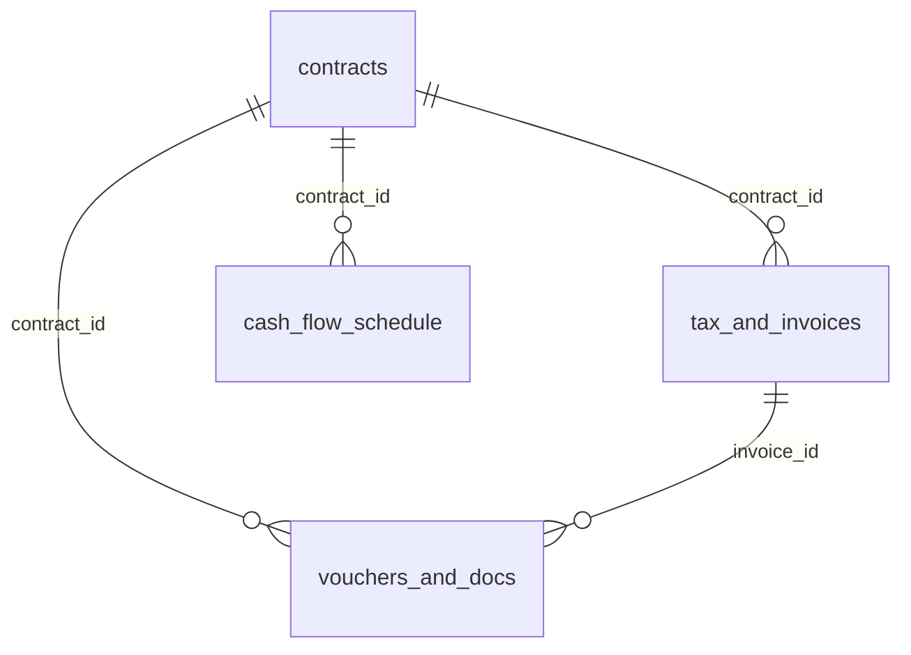

# Data model and analysis framework / 数据模型与分析框架

## Grain and joins

| Table | Grain | Primary key | Main fields |
| --- | --- | --- | --- |
| `contracts.csv` | One scenario contract | `contract_id` | Base cost, installment contract value, terminal disposal proceeds, term, annual receivable, source metadata |
| `vouchers_and_docs.csv` | One source document or voucher | `voucher_id` | Document type/date/reference, supplier, amount, invoice link |
| `tax_and_invoices.csv` | One simulated VAT invoice | `invoice_id` | Service period, issue date, net amount, rate, tax and gross |
| `cash_flow_schedule.csv` | One contract installment year | (`contract_id`, `installment_year`) | Due installment, separately planned disposal proceeds, actual installment receipt, outstanding installment, risk flag, snapshot date |

All amounts are in CNY unless a field explicitly says `source_contract_value` and `source_currency`. Monetary values use two decimal places. `source_ocid` is a traceability field, not an analytical join key.

## Core calculations

- **Invoice variance**: invoice `net_amount_cny` minus the sum of linked voucher `amount_cny`.
- **Duplicate source document**: repeated (`contract_id`, `document_reference`).
- **Cross-period invoice**: invoice year or month differs from its service period. This is a review signal, not an automatic violation.
- **Outstanding receivable**: scheduled receivable minus actual receipt; future installments remain forecast, not overdue.
- **Undiscounted plan surplus**: CNY 26 million of installments plus CNY 2 million terminal disposal proceeds less CNY 15 million base project cost = CNY 13 million. Voucher amounts are cost detail samples within the base cost and are not deducted again. This is not accounting profit.
- **Risk**: an unpaid installment is overdue only when `due_date` precedes the specified `as_of_date`.

## Dashboard pages

| Page | Main questions | Suggested visuals |
| --- | --- | --- |
| Operations and margin | How much is contracted, documented, and estimated as margin? | KPI cards, annual costs, document mix |
| Long-term cash risk | Which installments are due, paid, or overdue? | Annual schedule, outstanding trend, risk table |
| Tax and invoice review | Which invoices differ from source vouchers or cross periods? | Variance table, tax amount by period, exception counts |
| Voucher and supplier review | Are documents complete and references unique? | Supplier spend, document type, duplicate reference drill-through |

## Work sequence

1. Generate and validate the four CSV files.
2. Import the CSVs into SQLite and run `sql/reconciliation.sql` for row-level exceptions; extend it with tax and cross-period review rules.
3. Run the Pandas notebook for cleaning, exception review, risk scores, and forecast scenarios.
4. Review the four offline dashboard views and screenshots. The native Power BI import steps and measures are in `powerbi/POWER_BI_GUIDE.md`.
5. Open the native `.pbix` in Power BI Desktop, repoint the Excel source to the checkout's `powerbi/finance_model.xlsx` if refreshing, and verify the four pages before release.
